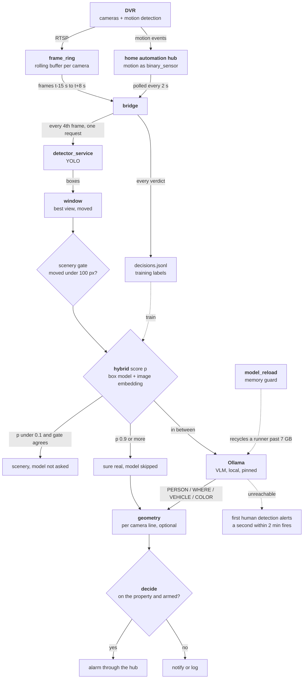

# vlm-security

A local VLM (Vision Language Model) decides whether camera motion should trigger an alarm.

A DVR's motion detection fires on foliage, rain, headlights and cats. An alarm wired straight to it gets ignored within a week. This puts a pipeline between the two: motion wakes it, an object detector finds the subject, cheap box arithmetic and a small trained model throw out the scenery, and a locally hosted VLM is asked what is left and where it is. Only a person or vehicle **on the property** raises the alarm.

Everything runs on your own hardware, with no cloud service or vendor account, and no footage leaves the house. With power and no internet it still detects, records and triggers.

## Try it in one command

```bash
ollama pull qwen3-vl:4b-instruct
uv run examples/ask.py frame.jpg
```

It prints what the model said, how that parsed, and what the bridge would decide if the alarm were armed. No home automation hub, no DVR, no cameras, just one image and a local model.

```text
--- model said ---
PERSON: no
PERSON_WHERE: none
VEHICLE: car
COLOR: silver
VEHICLE_WHERE: street

--- decision, if armed ---
  log: Silver Car (street)
```

## The pipeline



The stages run cheapest first, so each one keeps the next, slower one from seeing events it does not need to see.

| Module | Job |
|---|---|
| `vlmsec/frame_ring.py` | One ffmpeg per camera writes 2 fps JPEGs into a 45 s ring, so the seconds before an event are on disk |
| `vlmsec/detector_service.py` | YOLO on loopback, HTTP, holds the weights in memory and frees the GPU cache after each request |
| `vlmsec/window.py` | Event window, frame sampling, best view, travel, scenery gate |
| `vlmsec/hybrid.py`, `embed.py`, `train.py` | The hybrid score, its DINOv2 embedding, and its training from logged decisions |
| `vlmsec/vlm.py` | Prompt, answer contract, parse, and the retry rule |
| `vlmsec/geometry.py` | Optional boundary line per camera |
| `vlmsec/decide.py` | The decision, and the vision down rule |
| `vlmsec/bridge.py` | Polls the hub, runs one event through the stages, acts, logs |
| `vlmsec/model_reload.py` | Memory guard for pinned Ollama runners |
| `vlmsec/config.py` | Settings from env, then an untracked file, then generic defaults |

### 1. Event window

A motion event arrives seconds after the subject: the stream lags the scene, and the camera reports late. So the bridge waits 8 s, then reads the ring from 15 s before the event to 8 s after it. Reading DVR playback instead was slow, and many DVRs refuse a window that recent.

Every 4th frame of the window goes to the detector, plus the last one, in a single request. Reading every frame was most of an event's latency. Replaying real events at strides 1, 2, 4 and 8 gave the same class and confidence within a few hundredths, so stride 4 costs a quarter of the time for nothing measurable. The last frame stays because a subject arriving at the end of the window is the one most likely to matter.

The detector replaced motion ranking. The first version scored frames by pixel change on a 64x36 thumbnail and sent the 6 busiest to the VLM. A distant car is a few pixels at that size while a tree in the wind is hundreds, so the model was often handed frames the subject was not in and correctly answered "empty" about the wrong frames.

### 2. Best view

The decision keeps the top confidence of the window. The picture is a different frame: the largest box of the same class that does not touch a side edge (2% of the width on each side). The most confident box is often the subject entering, cut in half by the frame edge.

There is no sharpness check. A large blurred box can win over a smaller sharp one.

### 3. Moved

How far the chosen subject travelled across the window: the largest of its x span, y span and height span. Only boxes within 180 px of the chosen one count, so two still objects in different corners do not read as movement. Height counts because a person walking straight at the camera barely shifts their centre but grows.

### 4. Scenery gate

A subject that moved under 100 px is scenery: a bin, a plant, a reflection the detector calls a person every night. The threshold must sit well above the jitter of a still object's box, which light and wind move by tens of pixels. The gate is arithmetic on boxes already computed, so it runs before the model. Running it after meant the VLM described the same bin dozens of times an hour.

The gate's failure is a person who stands still. That is what the hybrid is for.

### 5. Hybrid score

Two small models, averaged into `p = (p_box + p_emb) / 2`:

* `p_box`: three random forests (different seeds) on box features: confidence, width, height, area, centre x and y, moved, camera, class and hour. Good at "this camera always has a box that size there".
* `p_emb`: a logistic regression on a DINOv2-small embedding of a square crop, 1.5 times the box's longer side, so some ground stays in. Good at "that is a plant, whatever the box says".

| p | Route | Why |
|---|---|---|
| under 0.1, and the gate said scenery | scenery, VLM not asked | both agree |
| under 0.1, and the gate let it through | VLM asked | the low band never hides a subject that is plainly moving |
| 0.1 to 0.9 | VLM asked | the gate's scenery call is reopened, this is where a still person is caught |
| 0.9 or more, person, vehicle or dog | sure real, VLM skipped | the detector names it and geometry places it |

The sure band works on the real side only. A sure scenery call from a model trained on the VLM's own verdicts would repeat the VLM's misses with nothing left to catch them.

Without a bundle on disk every score is None, and the pipeline behaves like the original MVP: the gate decides scenery and the VLM is asked about everything else.

#### Training

The bridge appends one row per judged event to `decisions.jsonl`, with the frame, box, class, confidence, travel, camera, time and, when the VLM was asked, its verdict as the label. Labelling this way costs no extra model calls. Human reviews use the same row format and win over the model's label for the same event, so a person can correct the cases that matter (a still person the VLM missed, say).

```bash
uv sync --group vision
uv run python -m vlmsec.train reviews.jsonl ~/.vlmsec/decisions.jsonl
```

The bundle is a joblib file that records the scikit-learn version it was built with. Loading refuses a mismatch, because a pickled forest does not load reliably across versions and a model that loads wrong scores wrong without saying so. joblib runs code from the file on load, so only load a bundle you trained.

### 6. Asking the VLM

One frame per request, with a prompt that ends in a fixed line format:

```text
PERSON: yes or no
PERSON_WHERE: house or street or none
VEHICLE: the type, or none
COLOR: the vehicle's main colour in one word, or none
VEHICLE_WHERE: house or street or none
```

A small model follows a line format far more reliably than it produces JSON. The parser also accepts the older four line answer with one `WHERE`.

What the contract learned:

* The person and the vehicle get their own place. With one `WHERE`, a person inside the gate with a car parked on the road behind them came back "street".
* When a person was seen, the person's place decides. A person on the property is what the alarm is for.
* A leading `EMPTY` is believed only when nothing is named after it. Models often answer `EMPTY ... VEHICLE: white car`.
* Anything in `VEHICLE` other than "none" is a vehicle. Matching a fixed word list threw away "blue SUV".
* A detection at 0.85 or more stands even when the model says the scene is empty.

The model is pinned with `keep_alive: -1`. Ollama's default unloads it after 5 idle minutes, and the first event after a quiet spell then waits for a cold load.

The retry rule: one retry after 5 s, only for an HTTP error that came back within 10 s. That is what a runner looks like between an unload and a load (see the memory guard). A refused connection or a timeout is a dead Ollama and fails at once. After a retry that also failed, there is no retry for 60 s, so a dead model does not add 5 s to every event.

### 7. Geometry, optional

The model judges position from what it sees, and it is wrong in a predictable way: through an open gate it sees the road and calls a car that has already entered "street". A camera does not move, so the boundary can be drawn once on a still frame.

```ini
GEOMETRY_JSON={"4": {"a": [0, 520], "b": [1280, 610], "property": "below"}}
```

`a` and `b` are two points on the boundary in pixels, `property` is the side of the line that is yours (`below`, `above`, `left` or `right`). The box's bottom centre, where the subject touches the ground, is the point tested. A camera with a line uses it. A camera without one uses the model's `WHERE`.

A sure call skips the model, so on a camera with no line nothing says where the subject is. That case counts as on the property, so the worst case is a false alarm.

### 8. Decision

| Verdict | Armed | Disarmed |
|---|---|---|
| person or vehicle on the property | alarm and notify | notify |
| on the street | log | log |
| nothing | ignore | ignore |

An unreachable hub counts as armed.

## The two decisions that matter

**Fail open.** If the model is unreachable, a human detection still counts. A vision pipeline that silently stops triggering is worse than none, because you believe you are covered.

The plain version (fire the siren on any human detection while the model is down) fires on every shadow the detector calls a person. The refinement in `decide.VisionDown`: with the model down and the alarm armed, the first human detection sends an urgent alert, and a second within 2 minutes fires the siren. Detections less than 45 s apart are one subject passing and count once. A person who stays triggers it. A single false box does not, and a human still gets the first alert at once. When the detector is down too, the motion event itself counts as the human detection.

**Never watch the inside.** Channels overlooking interior space (`RING_INDOOR_CHANNELS`) are removed after all other configuration, so no combination of settings routes a bedroom into the ring, a model or a log.

## Memory guard

A pinned runner never unloads, and over days its resident size grows until the machine swaps and, in the worst case, runs out of memory while the alarm depends on it. `model_reload.py` runs from cron or launchd every few minutes, measures each loaded model's runner, and reloads any over `MAX_RUNNER_MB` (7168 MB by default, sized for a 4B model whose fresh runner is around 4 GB).

* It never reloads while the bridge has a request in flight. The bridge writes a busy file while it asks the model, and a marker older than 90 s counts as a crashed bridge.
* After a reload it checks that a **new** runner process started. Ollama keeps a runner that is still serving a request, so the unload can return while the old pid is still up. Same pid: try again next run. New and small: allowed to be reloaded again later. New and already over the limit: the model starts that big, so the guard stops reloading it and reports it, instead of looping.
* A runner it cannot find or measure is never taken as small.

Runner size is RSS from `ps`, which is portable. On macOS the process's physical footprint (`proc_pid_rusage` through libproc, the number Activity Monitor shows) also counts GPU memory and is the better measure. It is not ported here.

The detector has the same problem in a smaller form: PyTorch keeps every batch's GPU buffers for reuse, so `detector_service.release()` empties the MPS or CUDA cache after each request.

## Known limitations

* No sharpness check in best view.
* The VLM is slow: seconds per frame on a small Mac. The gate and the hybrid exist to keep it out of the common case, but the uncommon case still waits.
* Geometry must be drawn by hand per camera, and it is only right while the camera does not move.
* The hybrid learns from the VLM's verdicts, so it learns the VLM's mistakes until a human reviews them.
* Thresholds (100 px, 0.1, 0.9, 0.85) were measured at one installation with 1280 px frames. Expect to tune them for yours.

## Setup

Settings resolve from environment variables, then `~/.home_network.conf` (`HOME_NETWORK_CONF` overrides the path), then generic defaults. Nothing about a specific installation belongs in this repository.

```ini
DVR_HOST=dvr.local
DVR_USER=...
DVR_PASS=...
HA_URL=http://homeassistant.local
HA_TOKEN=...
OLLAMA_URL=http://127.0.0.1:11434
VLM_MODEL=qwen3-vl:4b-instruct
RING_CHANNELS=1,2,3,4
RING_INDOOR_CHANNELS=7,8
CAMS_JSON={"binary_sensor.gate_motion": [4, "Front gate"]}
ARMED_ENTITY=alarm_control_panel.home
ALARM_SERVICE=script/turn_on
ALARM_TARGET=script.siren
NOTIFY_SERVICE=notify/notify
GEOMETRY_JSON={}
VLM_SCENE=...
VLM_RULES=...
```

| Key | Default | Meaning |
|---|---|---|
| `EVENT_BEFORE_S`, `EVENT_AFTER_S` | 15, 8 | the event window |
| `DETECT_STRIDE` | 4 | frames sent to the detector |
| `MOVE_MIN` | 100 | scenery gate, pixels |
| `HYBRID_LOW`, `HYBRID_HIGH` | 0.1, 0.9 | hybrid bands |
| `HYBRID_BUNDLE` | `~/.vlmsec/hybrid.joblib` | the trained bundle, absent means no hybrid |
| `MAX_RUNNER_MB` | 7168 | memory guard limit |
| `VLMSEC_RUN` | `~/.vlmsec` | decisions log, busy file, guard state |
| `RTSP_PATH` | `/ch{ch}` | your DVR's stream path, `{ch}` is replaced by the channel |
| `RTSP_PROXY` | 0 | relay RTSP through python on loopback, for macOS Local Network privacy |

**`VLM_SCENE` and `VLM_RULES` are the part only you can write.** They tell the model what counts as your property, and a stranger's copy will produce nonsense at your address.

```bash
uv sync --all-groups
uv run python -m vlmsec.config            # what resolved, never prints a secret
uv run python -m vlmsec.frame_ring
uv run python -m vlmsec.detector_service
uv run python -m vlmsec.bridge
uv run python -m vlmsec.model_reload      # from cron, every few minutes
```

The bridge and the ring are plain Python plus numpy, Pillow and scikit-learn. torch, transformers and ultralytics sit in the `vision` dependency group and are only imported by the detector and the embedding.

### Secrets

Environment variables or the local file cover everything. Optionally, on macOS, `config.py` can pull a secret from [passbox](https://github.com/gabrielkoerich/passbox), which gates each read behind Touch ID. Opt in with `HN_USE_PASSBOX=1`.

Long-running daemons should never use it: there is no login session under launchd to answer the prompt, so the call hangs. They read the untracked file instead.

## Checks

```bash
uv run basedpyright   # recommended mode, warnings fail, zero of either
uv run pytest -q
```

Type checking is strict, with no `# type: ignore` and no casts through `Any`. The libraries without useful types (scikit-learn, joblib, torch, transformers, ultralytics) have minimal stubs under `typings/` that cover only what the code calls. Tests use synthetic data and temp dirs only. CI runs both on every push to main and every pull request.

## Status

An MVP extracted from a working installation, published as a reference for the approach, not as a product. The stages and their order are what that installation runs. The production code around them (escalation, a second look a few seconds later, review tooling) is left out. Expect to adapt the prompt and the thresholds to your cameras.
